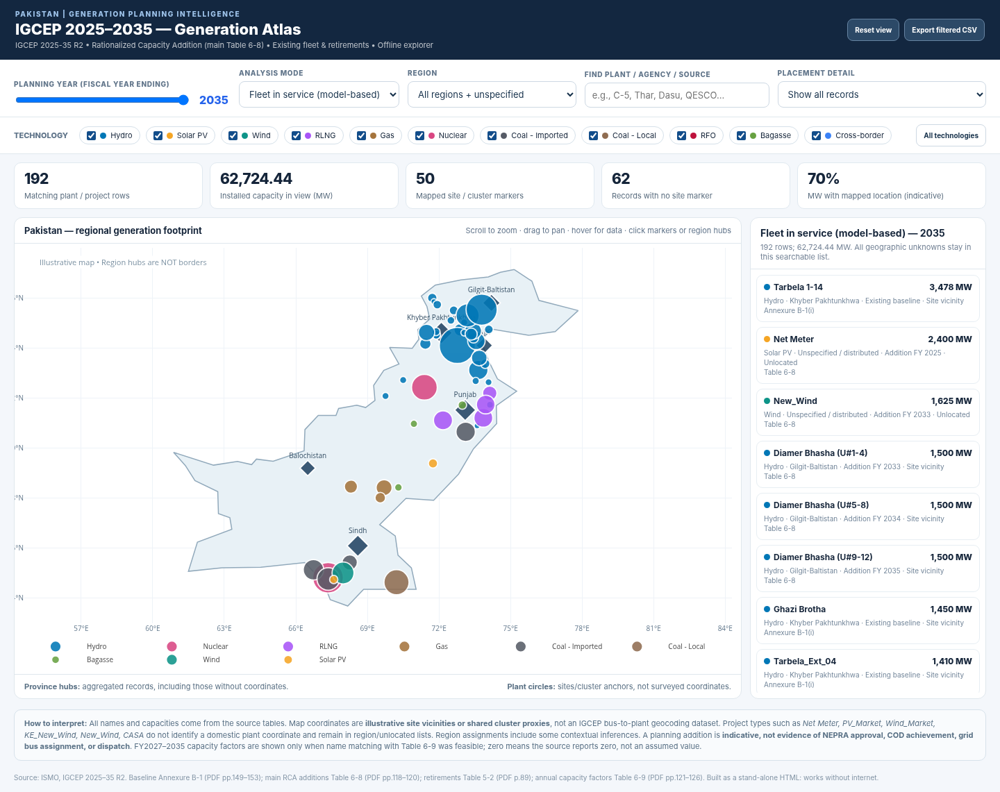

# Pakistan IGCEP 2025–2035 — Interactive Generation Atlas

An **unofficial learning and research prototype** that turns selected plant-level information from Pakistan's Revised Indicative Generation Capacity Expansion Plan (IGCEP) 2025–35 into an interactive geographic explorer.

**Planned live site:** https://muhammad-bilal-12.github.io/pakistan-igcep-atlas/



## Why I built this

While working through IGCEP tables, it was difficult to keep the geographic picture in view: *which project is being added, in which planning year, using which technology, and roughly where does it sit in Pakistan?*

This prototype was built to make that exploration faster and more intuitive for generation- and transmission-planning work.

## What the atlas can do

- Move through FY2025–FY2035.
- Inspect annual additions and cumulative additions.
- Review the baseline generation fleet and scheduled retirements extracted for the prototype.
- Filter by generation technology and region.
- Click mapped projects to inspect capacity and available source information.
- Inspect matched annual capacity-factor information where available in the source tables.
- Export the currently filtered project records as CSV from the interface.

## Source

Primary source: **Independent System and Market Operator (ISMO), Revised IGCEP 2025–35 (R2)**.

Official IGCEP library: https://ismo.gov.pk/library/igcep

The prototype primarily uses:

- Existing fleet: Annexure B-1.
- Retirement schedule: Table 5-2.
- Rationalized Capacity Addition schedule: Table 6-8.
- Annual capacity factors: Table 6-9.

The `data/IGCEP_Plant_Atlas_Data.xlsx` workbook contains the extracted working dataset used alongside the visualization.

## Important limitations

This is **not an official ISMO, NEPRA, NGC or Government of Pakistan tool**.

The IGCEP does not provide authoritative GIS coordinates or PSS/E connection buses for every project. Map coordinates in this prototype therefore include **illustrative site vicinities, shared plant/cluster locations, and contextual geographic inferences**. They must not be interpreted as official interconnection points, transmission buses, final project siting, or evidence of project approval/COD.

Entries such as market-based or distributed additions may not identify an individual plant location and are treated accordingly in the atlas.

The map is intended for **exploration and capacity building**, not as a substitute for the approved planning case, TSEP network model, PSS/E study files, regulatory determinations, or project-specific interconnection studies.

## AI-assisted development

The prototype was developed as an AI-assisted workflow. **GPT-6 Astra** was used as a coding and data-extraction assistant, while the study framing, requested functionality, review of outputs, and intended planning use were defined by the author.

## Repository contents

```text
pakistan-igcep-atlas/
├── index.html                         # Interactive atlas
├── README.md                          # Project notes and limitations
├── preview.png                        # Interface preview
├── .nojekyll                          # Serve static files directly on GitHub Pages
└── data/
    └── IGCEP_Plant_Atlas_Data.xlsx    # Extracted working dataset
```

## Suggested citation / attribution

If you use or build on this prototype, please cite the underlying **ISMO IGCEP 2025–35** as the official planning source and identify this repository as an unofficial visualization/prototype.

---

Built for learning around Pakistan's generation and transmission planning ecosystem.
